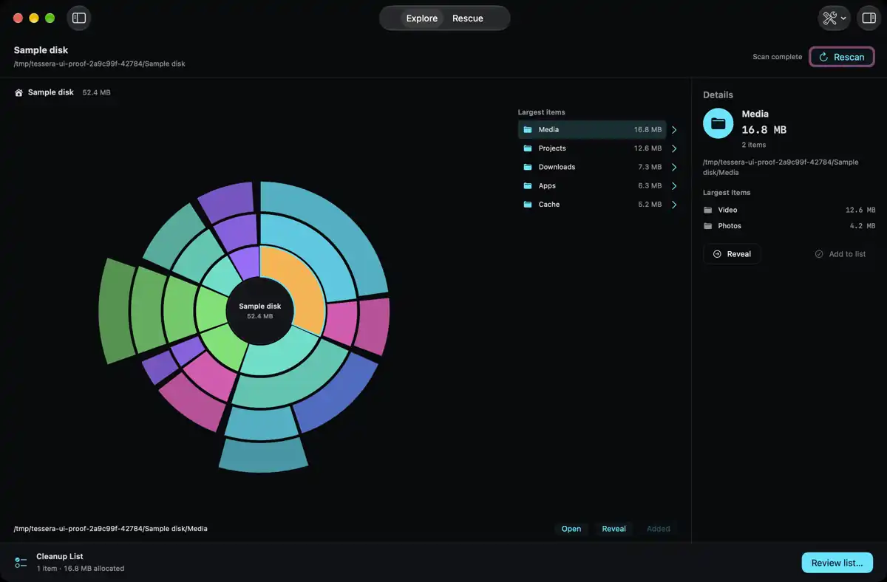

# Tessera

A fast, private, native macOS disk visualizer and cleaner. Scan any disk, cloud
folder, or network share; see what's using space in an interactive sunburst;
and review cleanup with duplicate detection, an app
uninstaller, dev-junk cleanup, and hidden-space tools. Disk analysis runs on your
Mac. Optional anonymous diagnostics contain no file names, paths or contents.

**Free and open source** under the [GPL-3.0](LICENSE).




[Native scan evidence and limits](docs/update/qualification.md)

## Features

- **Visual scan** — a parallel `getattrlistbulk` engine renders an interactive sunburst of
  your disk; multi-disk/cloud/network sources with an in-memory scan cache for
  instant switching.
- **Explore and Rescue** — a resizable workspace with a hideable source sidebar,
  optional item details, exact-path cleanup review and explicit coverage gaps.
  Scan status shows observed counts and the current phase. Scan time depends on
  the device and its access rules. Rescans read fresh metadata.
- **Cleanup suggestions** — rule-based detection of caches, dev junk (DerivedData,
  node_modules, package caches), Adobe media cache, logs, installers, and more.
  Add the suggestions you want to review. Nothing is added or deleted automatically.
- **Duplicate finder** — content-verified duplicates via a fast bounded fingerprint.
- **Large & Old Files** — filter by size, age, and kind.
- **By Kind lens** — see space grouped by Video / Photo / App / Archive / Code / …
- **File search** — filter files across the scan by name, size, age, and kind.
- **App Uninstaller** — remove an app *and* its leftovers (Caches, Application
  Support, Preferences, Containers, LaunchAgents…), conservatively matched.
- **Leftover finder** — support files left behind by apps you already deleted.
- **Hidden Space** — read and clear purgeable caches, APFS local snapshots, and
  Full-Disk-Access–gated files.
- **Safe by default** — staged items are reviewed in the Cleanup List; deletion
  defaults to **Move to Trash** (recoverable), with Delete Permanently as an
  explicit, confirmed option.

## Privacy

Disk contents and file paths stay on your Mac. Sparkle checks for signed updates.
Tessera also reads any network shares you choose to scan.

Anonymous PostHog analytics is optional and off by default. Turn it on in
Settings to share fixed screen names, scan times, counts, source type and cleanup
outcomes. No file names, paths, contents, searches or account names enter those
payloads. Crash reports omit error text and file paths. Location enrichment is
off. PostHog receives the network connection. Turning sharing off cancels
analytics requests and clears the local queue and random anonymous ID. It cannot
recall data already sent. There is no screen recording or account.

## Requirements

- macOS 26 (Tahoe) or later, Apple Silicon.
- Full Disk Access (granted in System Settings) to scan protected locations.

## Install

Download the latest `Tessera.dmg` from
[Releases](https://github.com/unknown6003/tessera/releases/latest),
drag Tessera to Applications, then right-click it and choose **Open** the first
time (the current channel uses a stable self-signed certificate).

## Building from source

```sh
# The Xcode project is generated from project.yml via XcodeGen.
xcodegen generate

xcodebuild -project Tessera.xcodeproj -scheme Tessera -configuration Debug build
xcodebuild -project Tessera.xcodeproj -scheme Tessera -configuration Debug test
```

To produce a distributable unsigned `.dmg`:

```sh
./release-unsigned.sh   # → dist/updates/Tessera-<version>.dmg
```

## Distribution

Distributed directly (not the Mac App Store — full-disk scanning and `tmutil` use
are incompatible with the App Sandbox) as a `.dmg`, with Sparkle for over-the-air
updates. Builds and the Sparkle appcast are published as GitHub Releases on this
repo, so they are anonymously downloadable. See [RELEASING.md](RELEASING.md).

The marketing site lives in [`web/`](web/) and deploys to GitHub Pages
(<https://unknown6003.github.io/tessera/>) via
[`.github/workflows/deploy-pages.yml`](.github/workflows/deploy-pages.yml).

Windows and Linux builds are planned; the packaging plan lives in
[DISTRIBUTION.md](DISTRIBUTION.md).

The major update's [design direction](docs/update/design-direction.md),
[language decision](docs/update/language-decision.md) and
[review record](docs/update/review.md) explain the current implementation.

## Contributing

Issues and pull requests are welcome. By contributing you agree that your
contributions are licensed under the GPL-3.0.

## License

[GNU General Public License v3.0](LICENSE) © 2026 Tessera contributors.
