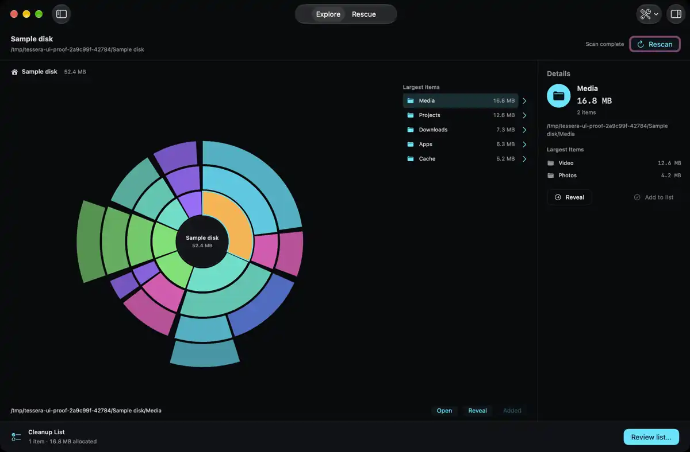
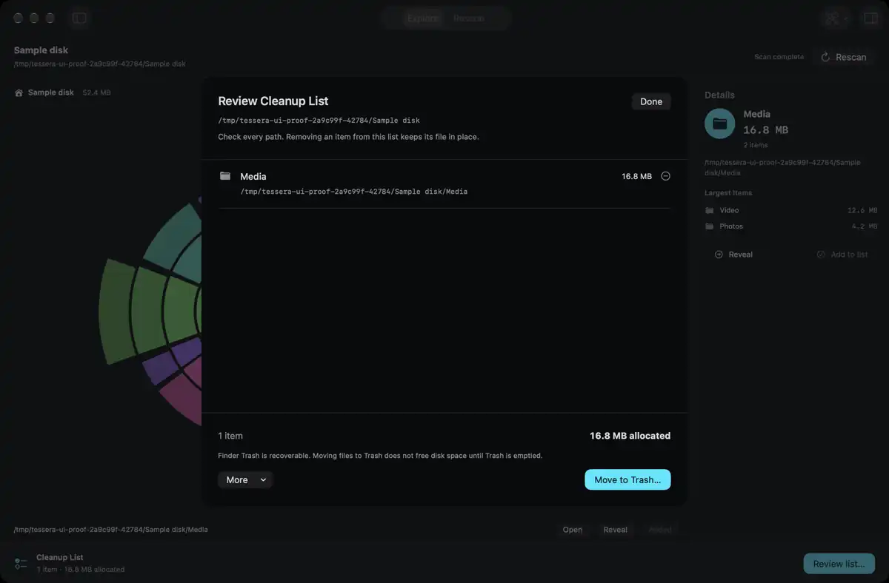
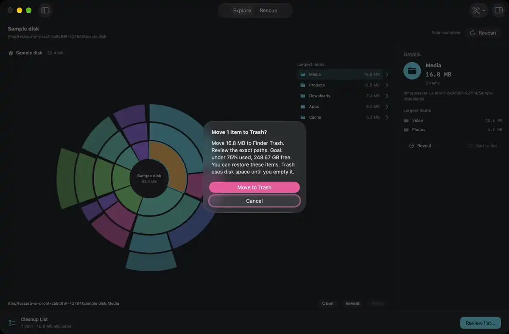

# Native qualification

The app uses SwiftUI, Swift and a small C bulk reader. Design research and source
reviews ran in parallel. Final integration and native checks ran in sequence.

## Measured behavior

The actual Release app at `5836a68` finished a root scan and cleanup classification
in 96.69 seconds on an M1 Max with 32 GiB RAM. It saw 4,469,000 files and 1,285,196
directories. Sampled peak RSS was 1,648,885,760 bytes. The measured main-actor
heartbeat was 120.8 ms. That run did not log its coverage-gap count. It does not
prove full access to the drive or a universal two-minute bound.

The prior Release run at `f80598c` finished in 132.56 seconds. The live filesystem,
metadata cache and host load changed between runs. This is duration evidence,
not an isolated percentage speedup. Profiling found repeated lowercase work in
the cleanup rule loop. The next revision computes the lowercase name once per
node.

An alternating warm fixture trial compared `301cb25` with `f80598c`. Both found
124,581 files and 455 directories, with no coverage gaps. Median peak RSS fell
from 61,538,304 to 50,003,968 bytes, or 18.74 percent. The total-time ranges
overlapped. See [the full measurement history](benchmark-history.json), including
failed runs and separate engine-only timings.

## Native tests and real input

`163c245` passed all 69 Debug tests and an unsigned Release build with Xcode 27.2
and Swift 6.4.2 on macOS 27.0.1. The suite covers wide and deep trees, long Unicode
names, fresh nested changes, identity checks, cancellation and removal safety.
The read-lease regression proves that cleanup stays blocked until a cancelled
background reader actually returns.

The native nine-file fixture has distinct known contents totalling 50 MiB.
Browse by Type, Big & Old Files, Search and Duplicates returned its expected
results. A real drag added Media from the chart to the Cleanup List. Review
opened with its full path and contents on three successive openings. Both native
confirmation dialogs opened and their Cancel buttons worked. No final removal
button was pressed in that UI pass. Hashes, sizes and modification times stayed
unchanged.

Command-Control-I opened Details once. Full keyboard focus, Escape dismissal,
rapid query cancellation and Finder-driven source replacement remain unproved
through native input. Frontmost-process guards refused some key events; changing
an AX text value did not update the SwiftUI query. These transport limits are not
counted as successful checks or as proved product failures.

## Actual window images

These images come from the owning macOS window at `163c245`, including its native
toolbar and sheets. Sources were hidden through the actual toolbar before
capture. Only disposable fixture paths appear. The UI source is unchanged by
the later resource-fork, measurement and automation fixes.

Each WebP is 1200 by 788 pixels, derived from a 2560 by 1680 compositor capture.
The original images and raw native logs remain on the linked Mac under
`/tmp/tessera-native-verification.1GZiGk/at163c245`.

## Final gates

`163c245` saved all seven finite layout variants but did not autoquit within its
120-second deadline. `fd1d84e` creates the output folder and dismisses the Review
sheet before termination. That narrow fix needs native execution.

The PR review then found two valid defects. `298201d` uses data-fork logical size
in both the bulk scan and removal identity. It also refreshes the Rescue plan
from the post-cleanup measurement, so capacity and target text use the same
sample as verification. The new resource-fork regression and updated capacity
checks need native execution before release.

Final CI, release signing, the signed launch smoke test, Sparkle signature and
published asset checks remain gates. No release is claimed by this document.
